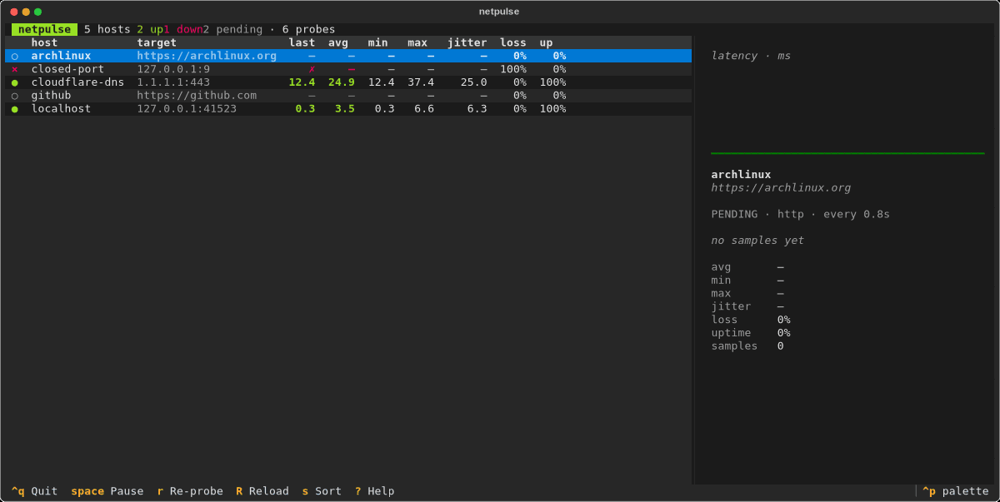
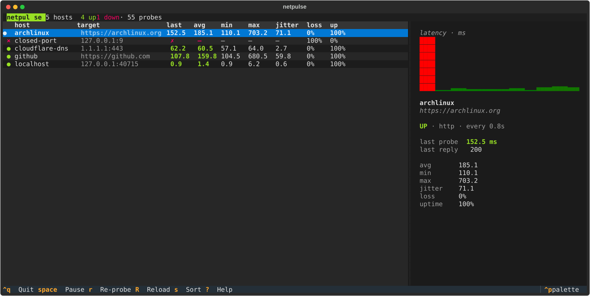

# netpulse

[](https://github.com/SHAWNiksDev/netpulse/actions/workflows/ci.yml)
[](https://www.python.org)
[](LICENSE)

A terminal dashboard that keeps an eye on your hosts — over TCP handshakes and
HTTP requests — and shows latency, jitter and packet loss in real time.



`netpulse` watching real hosts: sorting, the built-in help overlay and a paused
session are all part of the loop above.



## Why

ICMP ping needs raw sockets, which means root or file capabilities. Most of the
time that's also not what you actually care about: a host can answer pings
while its service is dead. `netpulse` measures what a regular user can reach:

- **TCP probes** time the connection handshake (`SYN → SYN/ACK`) to a host:port,
  which is a good RTT proxy *and* proves the port is open.
- **HTTP probes** time a full request until response headers arrive, and can
  assert an expected status code.

No privileges, no daemons, one config file.

## Features

- Async probing engine — every host gets its own interval, one slow host never
  blocks the others
- Rolling window statistics: avg / min / max, jitter, loss and uptime %
- Live sparkline of the selected host's history, with spikes highlighted
- Sort by name, status, average latency or loss; live re-sorting as statuses
  change; pause, manual re-probe, config reload on the fly (`R`)
- Strict TOML config with useful error messages
- Tested on Linux with Python 3.12–3.14 (POSIX-oriented, no privileges needed)

## Install

```sh
pipx install git+https://github.com/SHAWNiksDev/netpulse.git
# or: uv tool install git+https://github.com/SHAWNiksDev/netpulse.git
# or the classic way:
pip install git+https://github.com/SHAWNiksDev/netpulse.git
```

Or from a clone:

```sh
git clone https://github.com/SHAWNiksDev/netpulse.git
cd netpulse
python -m venv .venv && . .venv/bin/activate
pip install -e .
```

## Quick start

`netpulse` looks for `hosts.toml` in the current directory, then in
`~/.config/netpulse/hosts.toml` (or `$XDG_CONFIG_HOME/netpulse/hosts.toml`).
A minimal config:

```toml
[[host]]
name = "cloudflare"
address = "1.1.1.1"
port = 443

[[host]]
name = "github"
address = "github.com"
kind = "http"
```

```sh
netpulse                 # uses ./hosts.toml
netpulse -c ~/my.toml    # explicit path
```

## Configuration

Global defaults apply to every host unless overridden per-host:

| key        | default | meaning                                        |
| ---------- | ------- | ---------------------------------------------- |
| `interval` | `5`     | seconds between probes                         |
| `timeout`  | `3`     | probe timeout in seconds                       |
| `history`  | `240`   | samples kept per host for stats and the chart  |
| `warn_ms`  | `300`   | avg latency above this marks a host *degraded* |

Per-host keys:

| key            | applies to | meaning                                              |
| -------------- | ---------- | ---------------------------------------------------- |
| `name`         | all        | unique label shown in the table (required)           |
| `address`      | all        | hostname or IP (required)                            |
| `kind`         | all        | `tcp` (default) or `http`                            |
| `port`         | tcp        | port; may also be written as `address = "host:port"` or `address = "[::1]:22"` |
| `url`          | http       | defaults to `https://<address>`                      |
| `method`       | http       | HTTP verb, default `HEAD`                            |
| `expect_status`| http       | pin an exact status; default: anything below 400     |
| `interval`     | all        | per-host override                                    |
| `timeout`      | all        | per-host override                                    |

A fuller example lives in [`hosts.toml`](hosts.toml).

## Keys

| key       | action                          |
| --------- | ------------------------------- |
| `↑` `↓`   | select host                     |
| `s`       | cycle sort order                |
| `r`       | re-probe the selected host now  |
| `R`       | reload `hosts.toml`             |
| `space`   | pause / resume probing          |
| `?`       | help                            |
| `q`       | quit                            |

## How the numbers are made

- **TCP**: the wall time of `connect()` — one round trip for hosts on your LAN,
  plus SYN queue processing for remote ones. A refused port fails instantly and
  counts as down.
- **HTTP**: `HEAD` (or your method of choice) until response headers are read;
  redirects are followed. Status ≥ 400 (or a mismatched `expect_status`) counts
  as down; failed probes are excluded from the latency statistics.
- **Jitter** is the mean absolute difference between consecutive successful
  probes; **loss** is the share of failed probes in the window.

## Development

```sh
python -m venv .venv && . .venv/bin/activate
pip install -e '.[dev]'
pytest        # tests spin up local servers, no external network needed
ruff check .
```

`tools/screenshot.py` renders the dashboard headlessly and refreshes
`docs/screenshot.svg`.

## FAQ

**Why not ICMP?**
Raw sockets require root or `setcap cap_net_raw`. TCP/HTTP probes answer the
more useful question — "is the service reachable" — without any privileges.

**My host shows down but ping works.**
Something between you and the target drops SYN packets or the port is closed.
Select the host and check the `last reply` line in the side panel — refused
connections, timeouts and DNS failures all have distinct messages.

## License

[MIT](LICENSE)
